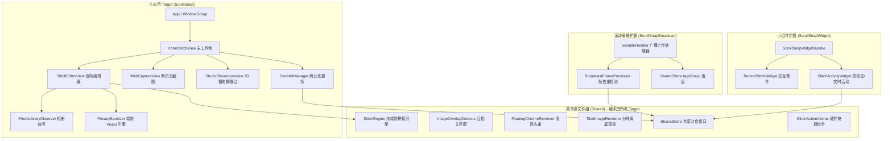

# ScrollSnap 滚动画布 (商业级 iOS 长截图效率工具)

  

  <strong>端侧无损连续拼接 · 苹果官方原生液态玻璃 · 每日免费2次 · ¥1.00 永久买断</strong>

  
  
  
  

---

## 快速导航与文档索引

* **[全量源码文件字典与模块职责速查手册 (CODEBASE_DIRECTORY.md)](docs/CODEBASE_DIRECTORY.md)**：包含工程中每一个文件的核心职责、关键类型、协作关系与重构记录。
* **[系统架构与全栈技术规范 (ARCHITECTURE.md)](docs/ARCHITECTURE.md)**：进程拓扑、App Group 数据总线、Metal 平铺渲染与内存边界控制。
* **[液态玻璃与视觉设计系统 (DESIGN_SYSTEM.md)](docs/DESIGN_SYSTEM.md)**：苹果官方原生玻璃材质、图标舱设计准则。
* **[录屏广播与低内存优化指南 (REPLAYKIT_BROADCAST_GUIDE.md)](docs/REPLAYKIT_BROADCAST_GUIDE.md)**：ReplayKit 广播流式分块写入与 50MB 内存红线控制。
* **合规与法律政策中心**：
  * [合规主页 (Index)](https://939243423.github.io/protocol__ScrollSnap/)
  * [隐私政策全文 (Privacy Policy)](https://939243423.github.io/protocol__ScrollSnap/privacy.html)
  * [最终用户许可协议 (EULA / Terms)](https://939243423.github.io/protocol__ScrollSnap/terms.html)
  * 开发者联系邮箱：`ruohui49@gmail.com`

---

## 核心技术优势与差异化特性

1. **商业模式：每日免费 2 次 + ¥1.00 永久买断**
   - 每日免费长截图 2 次（基于本地时间 00:00 自动刷新重置）。
   - ¥1.00 一次性永久买断（Tier 1 非消耗型项目），随 Apple ID 终身恢复，零订阅、零自动扣费。
2. **首创「双目无缝对比帘幕」(`BeforeAfterComparisonView`)**
   - 解决用户对算法拼合结果的信任痛点。左右推拉带微光的钛金激光游标，左侧直观展现原始截屏的吸顶栏与重叠冗余，右侧展现 100% 亚像素无缝拼合。
3. **微米级机械棘轮微调旋钮与实时画布位移 (`TactileSeamDialView`)**
   - 滑动滚轮或点击 `[-1]` / `[+1]` 按钮，接缝下方的切片以亚像素**实时平移**对齐，转动伴随清脆齿轮音效；0.0px 时翡翠绿霓光磁吸锁定。
4. **2.5x 视网膜光学放大镜 (`InteractiveLoupeView`)**
   - 悬浮于手指上方 32px，透镜内**真实克隆并 2.2x 放大**微观文字笔画与接缝基准线，内置刻度准星。
5. **3D 摄影棚海报直出 (`StudioShowroomView`)**
   - 支持 **沙漠钛**、**原色钛**、**深空黑**、**银白钛** 4 款苹果旗舰边框，自由 3D 透视倾斜与地面接触阴影动态响应，一键导出 4K 悬浮海报。
6. **极光毛玻璃“隐私刮刮乐”涂抹笔刷 (`LiquidBrushRedactionView`)**
   - 告别丑陋马赛克！支持像刮刮乐一样手绘涂抹极光毛玻璃（Frosted Glass Blur）、像素马赛克与机密黑条，保护隐私又极富高级质感。
7. **15 Pro 硬件联动与后台秒拼**
   - 完美适配 Action Button（操作按钮）与轻点背面（Back Tap）。连按截屏后轻按侧键，后台 0.3 秒无感拼好并直接存入系统剪贴板。

---

## 核心架构与 Target 拓扑

---

## 快速上手与本地调试

1. **在线体验免编译模拟器**：
   可以直接在浏览器中打开根目录下的 [`preview.html`](preview.html)，体验双目对比帘幕、机械棘轮滚轮、2.5x 放大镜及 3D 摄影棚。
2. **Xcode 项目配置**：
   - 打开 Xcode 15+ / 16+，导入项目；
   - 在 Signing & Capabilities 中将 App Groups 设置为 `group.com.scrollsnap`；
   - 使用 `ScrollSnap.storekit` 进行本地零成本离线购买调试。
