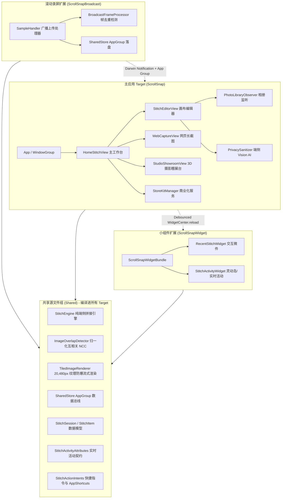

# ScrollSnap 滚动画布 (商业级 iOS 长截图效率工具)

<p align="center">
  
</p>

<p align="center">
  <strong>端侧无损连续拼接 · 苹果官方原生液态玻璃 · 每日免费2次 · ¥1.00 永久买断</strong>
</p>

<p align="center">
  <a href="https://github.com/939243423/ScrollSnap"></a>
  <a href="https://github.com/939243423/ScrollSnap"></a>
  <a href="https://github.com/939243423/ScrollSnap"></a>
  <a href="https://939243423.github.io/protocol__ScrollSnap/privacy.html"></a>
</p>

---

## 🌟 核心破局优势与差异化特性

1. **商业模式：每日免费 2 次 + ¥1.00 永久买断**
   - 每日免费长截图 2 次（基于本地时间 00:00 自动刷新重置）。
   - ¥1.00 一次性永久买断（Tier 1 非消耗型项目），随 Apple ID 终身恢复，零订阅、零自动扣费。
2. **微米级机械棘轮微调旋钮与接缝能量图谱 (`TactileSeamDialView`)**
   - 解决传统长截图软件接缝错位时无法微调的痛点。
   - 底部搭载瑞士表冠机械棘轮滚轮，滑动时触发物理齿轮咔哒声与刻度反馈。
   - 实时绘制 NCC 图像重叠互相关能量波形，对齐到最佳接缝（44pt）时点亮极光绿并触发强磁吸附锁定。
3. **极光毛玻璃“隐私刮刮乐”涂抹笔刷 (`LiquidBrushRedactionView`)**
   - 告别传统丑陋马赛克！支持像刮刮乐一样手绘涂抹极光毛玻璃（Frosted Glass Blur）、像素马赛克与机密墨水笔，保护隐私又极富高级质感。
4. **悬浮灵动胶囊监控岛与微信防糊哨兵 (`FloatingTelemetryIslandView`)**
   - 实时监控超长画布尺寸与离线渲染内存安全水位（34.2 MB / 50 MB 预警线）。
   - 当画幅超过 10,000px 时自动点亮黄色预警徽标，一键切换小红书 3:4 / 9 宫格切片导出，彻底防止微信服务端二次强压模糊。
5. **3D 摄影棚展示与海报直出 (`StudioShowroomView`)**
   - 长图自动套入 iPhone 15 Pro 钛金属原色机身，按住手势可自由进行 3D 空间倾角旋转（`rotateX` / `rotateY` 透视），搭配加州暖霞等四款棚拍光影，一键直出社交展示海报。
6. **15 Pro 硬件联动与后台秒拼**
   - 完美适配 Action Button（操作按钮）与轻点背面（Back Tap）。连按截屏后轻按侧键，后台 0.3 秒无感拼好并直接存入系统剪贴板。

---

## 🏛️ 核心架构与 Target 拓扑

项目由三个核心 Target 与一个共享代码组构成，完全解耦各进程职责：



---

## 📂 工程目录结构

```text
d:/ai/snap/
├── AppIcon.png                          # 1024x1024 官方萌趣 3D App 图标
├── preview.html                         # 全功能真实交互 H5 模拟原型
├── docs/                                # 核心技术规格与独立协议中心
│   ├── index.html                       # 合规与政策中心首页
│   ├── privacy.html                     # 隐私政策全文 (App Store 5.1.1)
│   ├── terms.html                       # 用户服务协议与 EULA
│   ├── ARCHITECTURE.md                  # 系统拓扑与跨进程总线深度解析
│   ├── STITCHING_ENGINE_SPEC.md         # NCC 算法、接缝搜索与拼接数学模型
│   ├── REPLAYKIT_BROADCAST_GUIDE.md     # 滚动录屏扩展与 50MB 内存防爆指南
│   └── DESIGN_SYSTEM.md                 # 原生系统材质组件规范
├── ScrollSnap/                          # 主应用 Target
│   ├── App/ScrollSnapApp.swift          # 应用生命周期与依赖注入
│   ├── Resources/
│   │   ├── Assets.xcassets/             # Xcode 资产目录 (AppIcon.appiconset)
│   │   ├── Info.plist                   # 权限声明与配置清单
│   │   └── ScrollSnap.storekit          # StoreKit 2 本地独立测试配置清单
│   ├── Services/                        # QuotaManager, StoreKitManager, PrivacySanitizer, TextExtractor
│   └── Views/
│       ├── Home/HomeStitchView.swift    # 主屏：快速拼接、连续截图感知、录屏引导
│       ├── StitchEditor/                # 接缝微调、棘轮旋钮、刮刮乐涂抹、雷达导轨、放大镜
│       ├── Studio/StudioShowroomView.swift # 3D 摄影棚展示海报制图
│       ├── Telemetry/FloatingTelemetryIslandView.swift # 灵动监控岛与微信防糊哨兵
│       ├── WebCapture/                  # WKWebView 网页全页渲染
│       └── Settings/SettingsView.swift  # 设置、缓存清理与合规政策链接
├── ScrollSnapBroadcast/                 # ReplayKit Broadcast Upload Extension
│   ├── SampleHandler.swift              # 屏幕帧捕获与 28MB 内存红线保护
│   └── BroadcastFrameProcessor.swift    # 垂直差分位移投影与快速去重
├── ScrollSnapWidget/                    # WidgetKit & ActivityKit Extension
│   ├── ScrollSnapWidgetBundle.swift     # 小组件套件
│   ├── RecentStitchWidget.swift         # iOS 17+ 交互式桌面小组件
│   └── StitchActivityWidget.swift       # 灵动岛 4 态与锁屏实时活动
└── Shared/                              # 共享代码（跨 Target 编译）
    ├── Models/                          # StitchSession, SubscriptionTier
    ├── Views/                           # Stage3DCoverFlowView, LiquidGlassStyle
    ├── Engine/                          # StitchEngine, ImageOverlapDetector, TiledImageRenderer, ImageSlicer
    ├── Services/                        # SharedStore (App Group 访问器)
    └── Intents/                         # AppShortcutsProvider, StitchActionIntents
```

---

## 📜 官方协议与合规中心

严格遵循 **Apple App Store 审核准则 5.1.1（数据收集与存储规范）** 与 Apple 标准最终用户许可协议：

- **合规与政策中心首页**：[https://939243423.github.io/protocol__ScrollSnap/](https://939243423.github.io/protocol__ScrollSnap/)
- **隐私政策全文**：[https://939243423.github.io/protocol__ScrollSnap/privacy.html](https://939243423.github.io/protocol__ScrollSnap/privacy.html)
- **用户服务协议与 EULA**：[https://939243423.github.io/protocol__ScrollSnap/terms.html](https://939243423.github.io/protocol__ScrollSnap/terms.html)
- **官方支持与提审联系邮箱**：`ruohui49@gmail.com`
- **协议存储仓库**：[https://github.com/939243423/protocol__ScrollSnap](https://github.com/939243423/protocol__ScrollSnap)

---

## 🚀 编译与本地调试指引

### 环境要求
- macOS Sonoma 14.5+ / macOS Sequoia 15.0+
- Xcode 15.4+ / Xcode 16.0+
- iOS 17.0+ 部署目标 (针对 iOS 17 AppIntent、Live Activity 与 StoreKit 2 优化)
- Swift 5.10 / Swift 6.0 语言模式

### 本地快速测试内购
工程已配置好 [`ScrollSnap/Resources/ScrollSnap.storekit`](file:///d:/ai/snap/ScrollSnap/Resources/ScrollSnap.storekit)。在 Xcode Scheme 中选择 `StoreKit Configuration -> ScrollSnap.storekit`，即可在无需连接网络与无需配置 App Store Connect 的情况下，本地直接模拟 ¥1.00 永久买断与恢复购买全流程！
