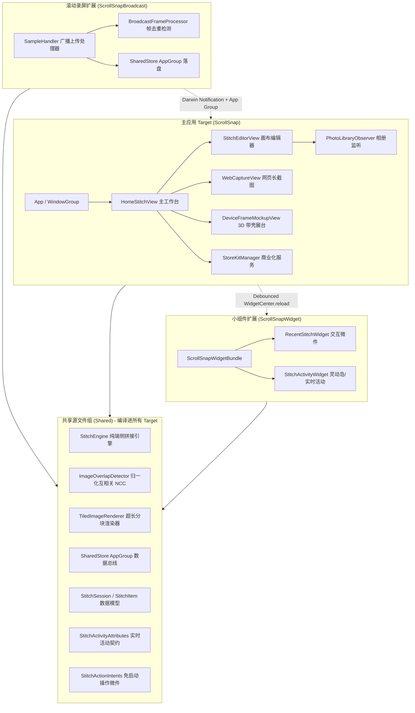

# ScrollSnap (长截图 iOS 生产级应用脚手架)

> 纯端侧、零隐私上报、高质感 Apple HIG 风格的 iOS 滚动长截图与连续多图智能拼接应用架构。
>
> 严格遵循 [IOS_AI_PROJECT_SCAFFOLD_GUIDE.md](file:///d:/ai/ios/IOS_AI_PROJECT_SCAFFOLD_GUIDE.md) 技术规范，支持 **ReplayKit 滚动录屏实时截取**、**相册连续截屏智能拼合**、**网页长截图渲染**、**无损隐私涂抹/马赛克** 以及 **3D 设备带壳套版导出**。

---

## 1. 核心架构与 Target 拓扑

项目由三个核心 Target 与一个共享代码组构成，完全解耦各进程职责：



---

## 2. 工程目录结构

```text
d:/ai/snap/
├── .agents/
│   ├── rules/                           # 团队开发与 AI 行为规则
│   │   ├── anti-slop.md                 # 去 AI 腔与工程表达规范
│   │   ├── frontend-design.md           # 8pt 网格、莫兰迪色盘与 HIG 规范
│   │   └── image-stitching-standard.md  # 图像拼接状态机、内存边界与 NCC 算法准则
│   └── skills/                          # Agent 技能包
│       ├── frontend-design/             # 前端设计技能
│       ├── stop-slop/                   # 文本去脂技能
│       ├── image-stitching-engine/      # 拼接算法与帧处理技能
│       ├── skill-creator/               # 技能生成器
│       └── skill-installer/             # 技能安装器
├── docs/                                # 核心技术规格与辅助理解文档
│   ├── ARCHITECTURE.md                  # 系统拓扑与跨进程总线深度解析
│   ├── STITCHING_ENGINE_SPEC.md         # NCC 算法、接缝搜索与拼接数学模型
│   ├── REPLAYKIT_BROADCAST_GUIDE.md     # 滚动录屏扩展与 50MB 内存防爆指南
│   ├── DESIGN_SYSTEM.md                 # 8pt 设计系统与材质组件规范
│   └── PROJECT_STATUS_AND_ROADMAP.md    # 项目路线图与测试用例矩阵
├── ScrollSnap/                          # 主应用 Target
│   ├── App/
│   │   └── ScrollSnapApp.swift          # 应用生命周期与依赖注入
│   ├── Views/
│   │   ├── Home/HomeStitchView.swift    # 主屏：快速拼接、最近连续截图感知、录屏引导
│   │   ├── StitchEditor/                # 长截图分块编辑、接缝微调、马赛克打码
│   │   ├── WebCapture/                  # WKWebView 网页全页渲染
│   │   ├── DeviceFrame/                 # 物理拟真 iPhone 边框带壳包装
│   │   └── Settings/                    # 设置与 StoreKit 2 会员订阅
│   └── Services/                        # 主应用私有单例服务
├── ScrollSnapBroadcast/                 # ReplayKit Broadcast Upload Extension
│   ├── SampleHandler.swift              # 屏幕帧捕获与 32MB 内存红线保护
│   └── BroadcastFrameProcessor.swift    # 垂直差分位移投影与快速去重
├── ScrollSnapWidget/                    # WidgetKit & ActivityKit Extension
│   ├── ScrollSnapWidgetBundle.swift     # 小组件套件
│   ├── RecentStitchWidget.swift         # iOS 17+ 交互式桌面小组件
│   └── StitchActivityWidget.swift       # 灵动岛 4 态与锁屏实时活动
└── Shared/                              # 共享代码（跨 Target 编译）
    ├── Models/                          # 统一数据契约
    ├── Views/                           # 共享视图 (Stage3DCoverFlowView 3D展台)
    ├── Engine/                          # 拼接计算引擎 (NCC / 投影 / 分块渲染)
    ├── Services/                        # SharedStore (App Group 访问器)
    └── Intents/                         # AppIntents 与 AppShortcutsProvider 快捷交互
```

---

## 3. 功能特性矩阵与商业化权益 (StoreKit 2)

| 模块 | 基础版 (Free Tier) | 专业版 (Pro VIP) | 技术底层支撑 |
|---|---|---|---|
| **相册多图拼接** | 支持最多 6 张连续截屏 | 无上限批量自动拼合 | `CoreGraphics` 投影与 NCC 归一化互相关 |
| **滚动录屏长截屏** | 单次捕获最长 20 屏 | 无限长画布录制 | `ReplayKit` 广播扩展 + 内存防抖 |
| **操作按钮 & 轻点背面** | 永久支持 (免打开 App 一键拼合) | 永久支持 (免打开 App 一键拼合) | `AppShortcutsProvider` + `AppIntent` |
| **吸顶/吸底固定栏过滤** | 自动剥离微信联系人栏与输入框 | 自动剥离微信联系人栏与输入框 | `ImageOverlapDetector` 差分行梯度检测 |
| **画布清晰度** | 标清压缩导出 (1.5x) | 原始无损 Retina 导出 (3x) | `CGImageDestination` 分块流式写盘 |
| **隐私保护涂抹** | 基础矩形马赛克 | 像素马赛克与纯黑打码脱敏 | 坐标相对矢量图层 + 非破坏性编辑 |
| **3D 展台与设备带壳** | 基础黑白简约壳 | 3D 钛金属质感、动态阴影与倒影 | `Stage3DCoverFlowView` 空间偏转视差 |
| **实时活动支持** | 永久免费完整体验 | 永久免费完整体验 | `ActivityKit` 4 态紧凑/展开布局 |

---

## 4. 关键技术突破与并发安全规范

1. **ReplayKit 50MB 内存防爆**：
   - 动态单色降采样（0.25x 采样率），灰度差分投影计算位移；
   - 确认关键帧后立即以 JPEG 压缩流写入 App Group 容器；
   - 坚决杜绝在 Extension 进程中保留 `CMSampleBuffer` 强引用，常驻内存压制在 28MB 以下。
2. **GPU 8192px 纹理溢出保护**：
   - 超长截图（常达 15,000~40,000px）直接加载单张 `UIImage` 会触发 GPU 内存雪崩或白屏；
   - 编辑器采用切片式 `LazyVStack` 与 `CATiledLayer` 分块虚拟化装载；
   - 导出阶段使用磁盘文件流式装配，避免全分辨率单图常驻堆内存。
3. **单例初始化死锁红线**：
   - 严禁在 `StitchEngine.shared`、`SharedStore.shared` 等单例构造器（`init()`）中同步调用外部单例，防止 `swift_once` 主线程递归死锁。
   - 所有 cross-service 初始化全部推迟至 `Task { @MainActor in ... }` 或首发调用。

---

## 5. 快速开始与编译指引

### 环境要求
- macOS Sonoma 14.5+ / macOS Sequoia 15.0+
- Xcode 15.4+ / Xcode 16.0+
- iOS 17.0+ 部署目标 (针对 iOS 17 AppIntent 与 WidgetKit 交互优化)
- Swift 5.10 / Swift 6 语言模式

### 启动步骤
1. 打开 `ScrollSnap.xcodeproj`。
2. 在 **Signing & Capabilities** 中为 `ScrollSnap`、`ScrollSnapBroadcast`、`ScrollSnapWidget` 三个 Target 配置统一的 Bundle Identifier 与 App Group：
   - 示例：`group.com.yourcompany.scrollsnap`
3. 选择 `ScrollSnap` 方案并启动至真实设备或 iPhone 模拟器。
4. 在控制中心添加「屏幕录制」快捷方式，长按即可选择 `ScrollSnap` 开启滚动截屏。
