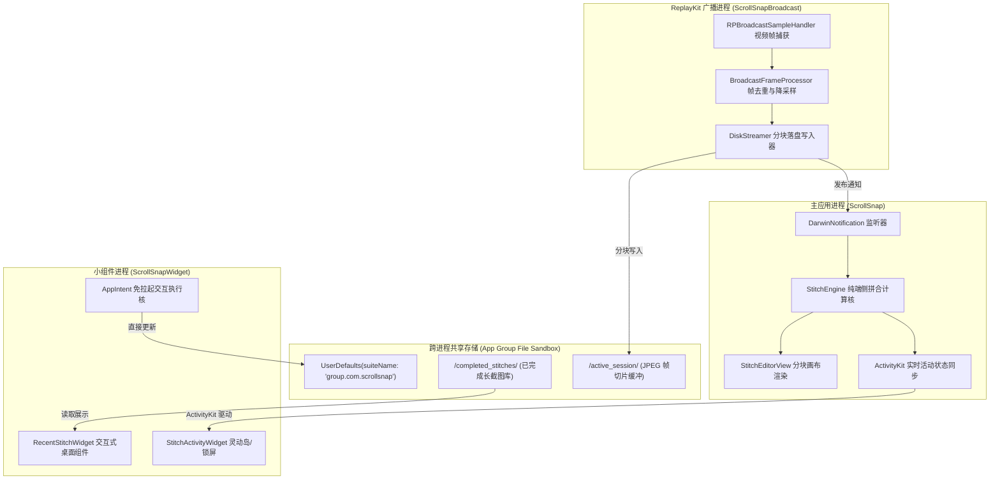

# 系统架构与全栈技术规范 (Architecture Blueprint)

本文档定义 `ScrollSnap` 的进程模型、跨进程总线、内存红线控制及线程安全边界。

---

## 1. 进程模型与 Target 拓扑

iOS 系统中，扩展（Extension）运行于与主应用完全隔离的独立沙盒进程空间中。本项目划分 3 个独立进程及 1 个共享源码编译单元：



---

## 2. 跨进程数据总线与通知同步

### 2.1 共享沙盒目录规范
主应用与扩展通过 `FileManager.default.containerURL(forSecurityApplicationGroupIdentifier: "group.com.scrollsnap")` 获取共享根目录：

```text
AppGroupContainer/
├── library/
│   └── Preferences/
│       └── group.com.scrollsnap.plist      # 用户配置、会员状态与最新截屏轻量元数据
└── cache/
    └── active_session/                      # 正在捕获的活跃会话
        ├── manifest.json                    # 会话切片清单与设备屏幕标定
        ├── slice_000.jpg                    # 初始首帧
        ├── slice_001.jpg                    # 位移候选帧
        └── ...
```

### 2.2 Darwin Core Foundation 跨进程极速通知
由于 `NotificationCenter.default` 仅在单进程有效，跨进程使用 Darwin 底层通知中心：

```swift
import Foundation

public final class CrossProcessNotifier {
    public static let sessionUpdatedNotification = "com.scrollsnap.broadcast.sessionUpdated"
    public static let sessionCompletedNotification = "com.scrollsnap.broadcast.sessionCompleted"

    public static func post(name: String) {
        let center = CFNotificationCenterGetDarwinNotifyCenter()
        let cfName = CFNotificationName(name as CFString)
        CFNotificationCenterPostNotification(center, cfName, nil, nil, true)
    }

    public static func observe(name: String, block: @escaping () -> Void) -> NSObjectProtocol {
        // 绑定 Darwin 监听并回调
        return DarwinNotificationObserver(name: name, handler: block)
    }
}
```

### 2.3 跨进程防抖刷新机制
在频繁更新数据时，严禁无节制刷新 `WidgetCenter`。所有刷新操作必须经由 300ms 计时器防抖：

```swift
private var reloadDebounceWorkItem: DispatchWorkItem?

public func notifyWidgetReloadDebounced(kind: String = "RecentStitchWidget") {
    reloadDebounceWorkItem?.cancel()
    let item = DispatchWorkItem {
        WidgetCenter.shared.reloadTimelines(ofKind: kind)
    }
    reloadDebounceWorkItem = item
    DispatchQueue.main.asyncAfter(deadline: .now() + 0.3, execute: item)
}
```

---

## 3. 内存预算与 Jetsam 守卫边界

| 进程空间 | 宿主限制 | 安全驻留内存预算 | 崩溃规避策略 |
|---|---|---|---|
| **ScrollSnapBroadcast** | 50MB (系统强杀) | `< 28MB` | 0.25x 单色灰度下采样，禁用 `CVPixelBuffer` 强持有，关键帧即时压缩写盘 |
| **ScrollSnapWidget** | 30MB (系统强杀) | `< 18MB` | 严禁加载全尺寸长截图，仅加载生成好的 200x200 缩略图 |
| **ScrollSnap (主应用)** | 依据设备可用 RAM | `< 180MB` | 超长画布禁止分配单一全尺寸 `UIImage`，使用切片渲染 (`LazyVStack`) 与 `CATiledLayer` |

---

## 4. 并发安全与线程死锁红线

### 4.1 严禁单例 `init()` 同步死锁
在 Swift 运行时中，`static let shared` 单例的初始化依托于 `swift_once`。若单例 A 的构造器同步调用单例 B，而单例 B 又访问单例 A，主线程将发生不可恢复的死锁导致启动直接闪退崩溃。

- **禁止行为**：
  ```swift
  // 错误示范：严禁在 init() 内同步调用其他单例
  final class StitchEngine {
      static let shared = StitchEngine()
      private init() {
          let _ = SharedStore.shared.loadSettings() // 触发循环依赖时即刻死锁
      }
  }
  ```
- **正确规范**：将跨单例交互推迟至具体方法执行时，或使用 `Task { @MainActor in ... }` 异步解耦。

### 4.2 纯端侧计算隔离
拼接运算（重叠搜索、NCC 矩阵乘积、接缝雕刻）严禁阻塞 `@MainActor`，必须封装于后台并发队列：

```swift
public final class StitchEngine {
    private let processingQueue = DispatchQueue(
        label: "com.scrollsnap.stitching.engine",
        qos: .userInitiated
    )

    public func stitchSlices(...) async throws -> StitchSession {
        return try await withCheckedThrowingContinuation { continuation in
            processingQueue.async {
                // 密集像素矩阵运算在后台池并发执行
            }
        }
    }
}
```


---

## 5. 交互渲染架构与特色交互管线

### 5.1 双目无缝对比帘幕管线 (`BeforeAfterComparisonView`)
采用双层几何裁切与光刃游标设计：
- **底层 (After)**：渲染 ScrollSnap 算法去重后的无缝会话；
- **顶层 (Before)**：渲染未经去重的原始连续截图，保留重复吸顶栏与重叠区，并用 `max(0, splitX)` 裁切遮罩 (`.clipped()`)；
- **分界光刃**：以 `GeometryReader` 实时抓取手势位置，计算归一化分割比例 `splitRatio`，驱动发光钛金细线平滑移动，并在拖拽时触发触觉反馈。

### 5.2 3D 摄影棚空间矩阵 (`StudioShowroomView`)
- **投影矩阵**：使用 SwiftUI 原生 `.rotation3DEffect(.degrees(dragY), axis: (0, 1, 0))` 与 `(1, 0, 0)` 实现真实 3D 倾斜；
- **动态环境阴影**：阴影的偏移量 `x` 与旋转角度 `dragY * 0.8` 联动，实现光照方向一致的物理投射；
- **边框材质着色**：采用 `LinearGradient` 模拟 **沙漠钛**、**原色钛**、**深空黑**、**银白钛** 的金属反射与高光倒角。

### 5.3 商业配额与 StoreKit 2 本地验签管线
- **双重守卫**：
  1. `QuotaManager`：基于设备本地日历管理每日免费 2 次配额；
  2. `StoreKitManager`：基于现代 StoreKit 2 异步流 `Transaction.updates`，密码学验证 `jwsRepresentation`，确保离线状态下防篡改；Pro 状态通过 `AppGroup` 共享至所有扩展。
