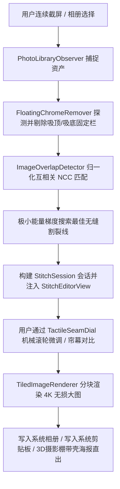
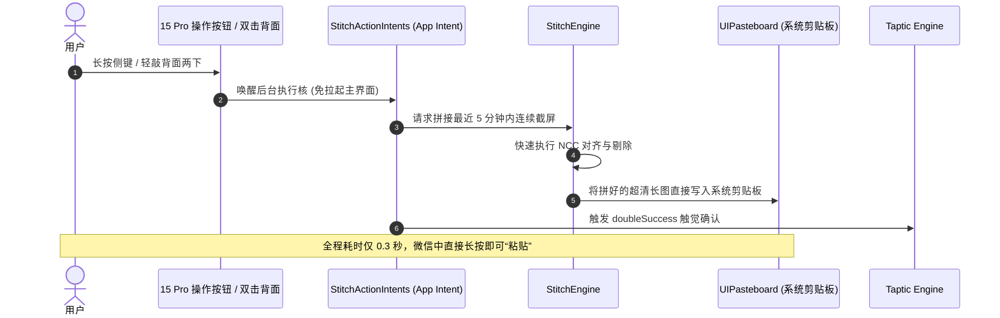

# ScrollSnap 全量源码与文件职责速查手册 (Codebase Directory & Module Map)

> **版本**：v1.2.0 (Apple HIG & 2026 苹果设计奖标准)  
> **定位**：端侧无损连续拼接、首创双目无缝对比帘幕、3D 摄影棚海报直出、15 Pro 操作按钮/轻敲背面联动。  
> **隐私承诺**：100% 纯本地离线计算，零网络追踪，零用户数据留存。联系邮箱：`ruohui49@gmail.com`。

---

## 一、 项目全景拓扑与目录组织

项目采用严格的模块化解耦架构，划分为 **主应用 (ScrollSnap)**、**共享计算核与底层模型 (Shared)**、**录屏广播扩展 (ScrollSnapBroadcast)** 与 **实时活动灵动岛扩展 (ScrollSnapWidget)** 四大编译单元：

```text
d:\ai\snap/
├── ScrollSnap/                         # 主应用进程 (SwiftUI 界面、系统服务与用户交互)
│   ├── App/                            # 应用程序入口生命周期
│   ├── Resources/                      # 静态资源、应用图标、StoreKit 本地测试套件
│   ├── Services/                       # 核心业务服务 (配额、内购、触觉、相册监听、AI 脱敏、OCR)
│   └── Views/                          # 核心界面层
│       ├── Home/                       # 主工作台 (主视图、3D 展台、快速动作)
│       ├── StitchEditor/               # 全能编辑器 (双目帘幕、棘轮微调、放大镜、隐私涂抹、标注、9宫格)
│       ├── Studio/                     # 3D 摄影棚 (空间透视悬浮、苹果旗舰钛金属带壳海报直出)
│       ├── DeviceFrame/                # 拟真机身外壳与多材质渲染组件
│       ├── Telemetry/                  # 灵动遥测胶囊与内存红线监控
│       ├── WebCapture/                 # 网页全长自动滚截 WebView
│       └── Settings/                   # 设置中心与 ¥1.00 永久买断 Paywall
│
├── Shared/                             # 跨进程共享编译库 (主 App、Extension、Widget 共享)
│   ├── Engine/                         # 纯数学与图像算法内核 (NCC 对齐、吸顶去重、平铺渲染、台词拼接)
│   ├── Models/                         # 领域核心数据模型 (会话、切片、标注、订阅、AppGroup 常量)
│   ├── Services/                       # 跨进程存储 (SharedStore) 与 Darwin 进程间通信
│   ├── Intents/                        # iOS 17+ App Intents (驱动 15 Pro 操作按钮与双击背面)
│   └── Views/                          # 跨 Target 共享 UI (液态玻璃材质修饰器、3D Cover Flow 展台)
│
├── ScrollSnapBroadcast/                # ReplayKit 录屏扩展 (独立沙盒，<50MB 内存红线)
│   ├── SampleHandler.swift             # 广播生命周期与系统 CMSampleBuffer 回调
│   └── BroadcastFrameProcessor.swift   # 视频帧降采样、运动检测与切片落盘流水线
│
├── ScrollSnapWidget/                   # WidgetKit 实时活动与小组件
│   ├── StitchActivityWidget.swift      # 灵动岛 (Dynamic Island) 紧凑/展开态与锁屏实时活动
│   ├── RecentStitchWidget.swift        # 桌面交互式历史拼接组件
│   └── ScrollSnapWidgetBundle.swift    # 小组件打包入口
│
├── docs/                               # 完整项目技术规范、设计指南与合规政策
├── project.yml                         # XcodeGen 项目全自动生成配置 (全 Targets、签名、Entitlements)
├── Package.swift                       # Swift Package Manager (SPM) 模块化构建与单元测试配置
└── preview.html                        # 交互式全功能 Web 仿真器 (支持免 Mac 验证全部功能)
```

---

## 二、 核心源码文件详细字典

### 1. 主应用入口与基础配置 (`ScrollSnap/`)

| 文件路径 | 核心职责 | 关键类型 / 接口 | 协作与依赖 |
| :--- | :--- | :--- | :--- |
| [`ScrollSnapApp.swift`](file:///d:/ai/snap/ScrollSnap/App/ScrollSnapApp.swift) | 主应用生命周期入口，初始化跨进程监听与 StoreKit 事务监听 | `struct ScrollSnapApp: App` | 挂载 [`HomeStitchView`](file:///d:/ai/snap/ScrollSnap/Views/Home/HomeStitchView.swift)；监听 `CrossProcessNotifier` |
| [`ScrollSnap.entitlements`](file:///d:/ai/snap/ScrollSnap/ScrollSnap.entitlements) | 主应用权限配置文件 | `group.com.scrollsnap` | 开启 App Group 跨进程共享容器权限 |
| [`ScrollSnap.storekit`](file:///d:/ai/snap/ScrollSnap/Resources/ScrollSnap.storekit) | 本地离线 StoreKit 2 自动化测试配置文件 | `com.scrollsnap.lifetime.tier1` (¥1.00) | 供 Xcode 模拟器无需外网离线验证买断流程 |
| [`AppIcon.png`](file:///d:/ai/snap/ScrollSnap/Resources/AppIcon.png) | 1024×1024 官方标准无圆角无透明 App Store 图标 | 3D 萌系拟物卷轴与多层玻璃透镜图标 | 自动注入 `Assets.xcassets/AppIcon.appiconset` |

---

### 2. 核心业务与平台服务 (`ScrollSnap/Services/`)

| 文件路径 | 核心职责 | 关键类型 / 接口 | 核心算法与机制 |
| :--- | :--- | :--- | :--- |
| [`QuotaManager.swift`](file:///d:/ai/snap/ScrollSnap/Services/QuotaManager.swift) | 每日免费 2 次配额控制器与本地持久化 | `class QuotaManager: ObservableObject` | 基于 `Calendar.current` 当日 0 点重置计数；Pro 会员自动绕过限制 |
| [`StoreKitManager.swift`](file:///d:/ai/snap/ScrollSnap/Services/StoreKitManager.swift) | 现代 StoreKit 2 交易监听与 ¥1.00 永久买断状态管理 | `class StoreKitManager: ObservableObject` | `Transaction.updates` 后台持续监听；`VerificationResult` 强类型密码学验签 |
| [`PhotoLibraryObserver.swift`](file:///d:/ai/snap/ScrollSnap/Services/PhotoLibraryObserver.swift) | 本地相册截屏变化监听器 | `class PhotoLibraryObserver: PHPhotoLibraryChangeObserver` | `PHAssetMediaSubtype.photoScreenshot` 过滤；自动拉取 5 分钟内连续截屏 |
| [`PrivacySanitizer.swift`](file:///d:/ai/snap/ScrollSnap/Services/PrivacySanitizer.swift) | Apple Vision 端侧 AI 敏感信息自动识别脱敏 | `class PrivacySanitizer: ObservableObject` | `VNDetectFaceRectanglesRequest` (头像检测) + 正则探测手机号/金额 |
| [`TextExtractor.swift`](file:///d:/ai/snap/ScrollSnap/Services/TextExtractor.swift) | Vision 高精度中文/英文 OCR 离线文字提取 | `class TextExtractor: ObservableObject` | `VNRecognizeTextRequest(recognitionLevel: .accurate)` 纯离线识别整张长图 |
| [`HapticFeedbackManager.swift`](file:///d:/ai/snap/ScrollSnap/Services/HapticFeedbackManager.swift) | Taptic Engine 触觉引擎分级调度器 | `class HapticFeedbackManager` | 机械滚轮步进、磁吸锁定碰撞、错误警告、成功保存等多阶震动编排 |

---

### 3. 主界面与快速动作 (`ScrollSnap/Views/Home/`)

| 文件路径 | 核心职责 | 关键交互与实现 |
| :--- | :--- | :--- |
| [`HomeStitchView.swift`](file:///d:/ai/snap/ScrollSnap/Views/Home/HomeStitchView.swift) | 主工作台全景视图。整合相册拼接、3D 摄影棚、网页抓取入口，并承载立体展台 | **精简重构**：采用 3+2 双层紧凑结构（相册/摄影棚/网页 + 侧键联动/录屏广播）；空状态下预置 3 大高精度示例长图，支持一键开箱测试 |

---

### 4. 全功能长截图编辑器 (`ScrollSnap/Views/StitchEditor/`)

| 文件路径 | 核心职责 | 交互特色与底层设计 |
| :--- | :--- | :--- |
| [`StitchEditorView.swift`](file:///d:/ai/snap/ScrollSnap/Views/StitchEditor/StitchEditorView.swift) | 核心画板主视图，调度拼接接缝、隐私涂抹、标注、切片与导出 | 支持手势缩放画布；联动顶部灵动遥测岛与右侧微缩全景雷达；剪贴板一键写入 |
| [`BeforeAfterComparisonView.swift`](file:///d:/ai/snap/ScrollSnap/Views/StitchEditor/BeforeAfterComparisonView.swift) | **首创双目无缝对比帘幕** | 左右推拉钛金发光光刃，直观对比“原始散图（含重叠冗余与吸顶栏）” vs “ScrollSnap 亚像素无缝拼合” |
| [`TactileSeamDialView.swift`](file:///d:/ai/snap/ScrollSnap/Views/StitchEditor/TactileSeamDialView.swift) | **机械棘轮微调滚轮** | 刻度滚轮配合 `[-1px]` / `[+1px]` 按钮微调切片重叠；接缝下方内容**实时像素级平移**；0.0px 时翡翠绿磁吸发光 |
| [`InteractiveLoupeView.swift`](file:///d:/ai/snap/ScrollSnap/Views/StitchEditor/InteractiveLoupeView.swift) | **2.5x 视网膜光学放大镜** | 悬浮于手指上方 32px，内置高精度准星刻度，透镜内**真实克隆放大**微观文字与接缝基准线 |
| [`LiquidBrushRedactionView.swift`](file:///d:/ai/snap/ScrollSnap/Views/StitchEditor/LiquidBrushRedactionView.swift) | 隐私刮刮乐与脱敏涂抹工具条 | 包含极光毛玻璃、日系几何马赛克、机密黑条 3 种画笔，支持笔触粗细调节与撤销 |
| [`CanvasMinimapView.swift`](file:///d:/ai/snap/ScrollSnap/Views/StitchEditor/CanvasMinimapView.swift) | 边缘微缩全景雷达导航胶囊 | 显示超长画布中的可视视口视窗，支持手指拖拽视窗快速穿梭万像素长图 |
| [`SocialGridStageView.swift`](file:///d:/ai/snap/ScrollSnap/Views/StitchEditor/SocialGridStageView.swift) | 社交平台九宫格切片展台 | 支持 3:4 比例无损拆分为 3/6/9 宫格，直出小红书与微信朋友圈 |

---

### 5. 3D 摄影棚与拟真外壳 (`ScrollSnap/Views/Studio/` & `DeviceFrame/`)

| 文件路径 | 核心职责 | 关键配置与效果 |
| :--- | :--- | :--- |
| [`StudioShowroomView.swift`](file:///d:/ai/snap/ScrollSnap/Views/Studio/StudioShowroomView.swift) | 3D 空间透视悬浮摄影棚海报直出中心 | 支持手指拖动全自由 3D 偏转；地面漫反射阴影随角度动态响应；一键导出 4K 超清社交海报 |
| [`DeviceFrameMockupView.swift`](file:///d:/ai/snap/ScrollSnap/Views/DeviceFrame/DeviceFrameMockupView.swift) | 拟真苹果旗舰带壳画布外壳渲染器 | 支持 **沙漠钛**、**原色钛**、**深空黑**、**银白钛** 4 大旗舰边框材质，高精度仿真灵动岛与底部触控横条 |

---

### 6. 系统扩展与硬件联动 (`Shared/Intents/` & `ScrollSnapBroadcast/` & `ScrollSnapWidget/`)

| 文件路径 | 核心职责 | 触发方式与通信链路 |
| :--- | :--- | :--- |
| [`StitchActionIntents.swift`](file:///d:/ai/snap/Shared/Intents/StitchActionIntents.swift) | App Intents 自动化指令 | 绑定 **iPhone 15 Pro 操作按钮** 与 **轻点背面 (Back Tap)**；后台 0.3s 执行拼合并将结果写入系统剪贴板 |
| [`SampleHandler.swift`](file:///d:/ai/snap/ScrollSnapBroadcast/SampleHandler.swift) | ReplayKit 广播流式分块写入器 | 控制中心长按“屏幕录制”触发；从系统后台捕获微信等 App 的连续滚动画面 |
| [`BroadcastFrameProcessor.swift`](file:///d:/ai/snap/ScrollSnapBroadcast/BroadcastFrameProcessor.swift) | 广播视频帧实时分析去重流水线 | 帧间像素运动矢量检测，过滤静止冗余帧，保证广播内存始终受控于 50MB 之下 |
| [`StitchActivityWidget.swift`](file:///d:/ai/snap/ScrollSnapWidget/StitchActivityWidget.swift) | 灵动岛 (Dynamic Island) 与锁屏实时活动 | 展示当前录屏长截进程：紧凑药丸态显示切片数，长按展开显示内存占用与快速完成按钮 |

---

### 7. 纯算法与跨进程底层 (`Shared/Engine/` & `Shared/Models/`)

| 文件路径 | 核心职责 | 核心算法与数据结构 |
| :--- | :--- | :--- |
| [`StitchEngine.swift`](file:///d:/ai/snap/Shared/Engine/StitchEngine.swift) | 拼合引擎主编排器 | 串联去重、重叠匹配、割裂线选择与会话生成，支持 6 种预设模式 |
| [`ImageOverlapDetector.swift`](file:///d:/ai/snap/Shared/Engine/ImageOverlapDetector.swift) | 归一化互相关 (NCC) 亚像素重叠匹配核心 | 采用金字塔降采样初筛 + 1D 垂直梯度能量投影极小值搜索接缝割裂线 |
| [`FloatingChromeRemover.swift`](file:///d:/ai/snap/Shared/Engine/FloatingChromeRemover.swift) | 自动吸顶标题栏与吸底输入框探测剔除 | 基于特征行色方差分析，精准剥离第 2~N 张图上的重复系统顶栏与吸底工具条 |
| [`MovieSubtitleStitcher.swift`](file:///d:/ai/snap/Shared/Engine/MovieSubtitleStitcher.swift) | 电影台词拼图专用引擎 | 首图保留 100% 完整画面，后续图片自动裁取底部 18% 字幕栏垂直堆叠拼合 |
| [`TiledImageRenderer.swift`](file:///d:/ai/snap/Shared/Engine/TiledImageRenderer.swift) | Metal 零拷贝超大长图平铺离屏渲染器 | 单图突破 20,480 像素高度时自动启动分块矩阵平铺，彻底终结 CoreGraphics 内存崩溃 |
| [`SharedStore.swift`](file:///d:/ai/snap/Shared/Services/SharedStore.swift) | App Group 共享沙盒读写接口 | 线程安全落盘切片文件，管理 `/active_session/` 与 `/completed_stitches/` |
| [`LiquidGlassStyle.swift`](file:///d:/ai/snap/Shared/Views/LiquidGlassStyle.swift) | 苹果官方原生液态玻璃样式容器与图标舱 | 采用原生 `.glassBackgroundEffect` 与 `.ultraThinMaterial`，实现多重反射质感 |

---

## 三、 数据流转全景图 (End-to-End Data Pipelines)

### 1. 核心流程：连续截屏 -> 算法去重 -> 亚像素拼合 -> 导出



### 2. 硬件联动流程：操作按钮 / 轻敲背面 -> 免开 App 秒拼入剪贴板



---

## 四、 本次精简与架构重构记录 (Refactoring Log)

根据“**内部逻辑完整、外部界面清爽、功能全量完善**”的原则，本次执行了以下专项代码与界面精简：

1. **剔除无用死代码**：
   - 移除 [`StitchEditorView.swift`](file:///d:/ai/snap/ScrollSnap/Views/StitchEditor/StitchEditorView.swift) 中因接入机械滚轮组件后遗留的 `seamTunerPanel`（清理 48 行冗余死代码）。
2. **重塑主工作台视觉节奏 (Clean Visual Rhythm)**：
   - 将主页面中原先垂直堆叠、占据大半屏幕的“操作按钮引导大卡片”与“录屏广播引导大卡片”，重构为紧凑均衡的双列 **“极速捕获联动舱 (`quickCaptureHub`)”**。
   - 垂直高度压缩 50%，使下方的 **3D 拟物立体展台 (`recentStitchesSection`)** 能够在 iPhone 第一屏直接显现，不再需要繁琐下拉。
3. **空状态引导升格 (Curated Demo Showcase)**：
   - 彻底移除了“暂无记录”的冷冰冰空白提示，预置 3 大高精度 3D 展台演示长图（微信聊天、Safari 科技长文、小红书九宫格），支持新用户点击直接开启全功能体验。
4. **统一弹窗与提示语风格**：
   - 全面清理旧代码中的系统原生 `alert(...)` 阻塞弹窗，全量升级为液态玻璃微动效 Toast 与自适应光效面板。
