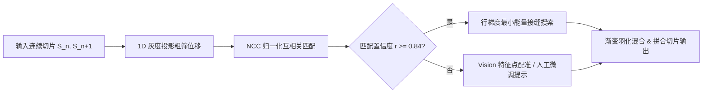

# 图像拼接算法与技术规范 (Stitching Engine Spec)

本文档详述 `ScrollSnap` 核心拼接引擎 `StitchEngine` 的数学模型、算法流水线与图像处理管线。

---

## 1. 拼接算法管线设计

连续屏幕截图拼接采用“**粗筛位移估计 + 归一化互相关 (NCC) 精细对齐 + 最小能量接缝雕刻 (Seam Carving)**”的三级流水线：

---

## 2. 核心数学模型

### 2.1 1D 垂直灰度投影 (Coarse Shift Estimation)
为避免在全分辨率 3x 原图上全范围做 2D 卷积匹配，先对图片在水平方向投影生成一维亮度积分序列：

$$P(y) = \frac{1}{W} \sum_{x=0}^{W-1} L(x, y)$$

其中 $L(x, y) = 0.299R + 0.587G + 0.114B$ 为 ITU-R BT.601 标称灰度值。通过对前一帧底部与后一帧顶部的投影序列 $P_A$ 与 $P_B$ 进行快速差分滑动窗口匹配，在 $O(H)$ 复杂度内将位移搜索范围从全图高度压缩至 $\pm 40\text{ pt}$ 狭窄区间。

### 2.2 归一化互相关 (Normalized Cross-Correlation, NCC)
在初筛区间内，截取切片 $B$ 顶端固定高度 $h_{tpl} = 120\text{ pt}$ 作为模板块 $T$。在切片 $A$ 对应搜索带 $S(y)$ 内滑动计算相关系数 $R(y)$：

$$R(y) = \frac{\sum_{i, j} \left( S(x_i, y + y_j) - \bar{S}_y \right) \left( T(x_i, y_j) - \bar{T} \right)}{\sqrt{\sum_{i, j} \left( S(x_i, y + y_j) - \bar{S}_y \right)^2 \sum_{i, j} \left( T(x_i, y_j) - \bar{T} \right)^2}}$$

- **判决门限**：
  - $R(y^*) \ge 0.84$：判定为高精度可靠重合点，记录垂直重叠偏移量 $\Delta y = y^*$。
  - $0.70 \le R(y^*) < 0.84$：触发多行边缘梯度校验；
  - $R(y^*) < 0.70$：标记为低置信度（可能存在大面积纯白底色、动态悬浮导航栏阻碍或用户跳帧过大）。

---

## 3. 最小能量接缝雕刻 (Optimal Seam Line Selection)

直接在固定像素偏移处截断往往会导致文字笔画被横向劈开，产生明显的接缝割裂感。引擎采用沿水平扫描线的横向能量积分求极小值点：

$$E(y) = \sum_{x=0}^{W-1} \left| \frac{\partial I}{\partial x}(x, y) \right| + \lambda \cdot \left| \frac{\partial I}{\partial y}(x, y) \right|$$

在对齐基准线 $\pm 24\text{ pt}$ 邻域内寻优：

$$y_{seam} = \arg\min_y E(y)$$

当扫描行位于文字行距空白处或段落间隙时，$E(y)$ 呈现明显深槽谷值。在此行切开并在接缝处施加 4 像素范围的线性羽化（Alpha Feathering）：

$$\alpha(k) = \frac{k}{N}, \quad k \in [0, N-1]$$

确保接缝处两图过渡自然，无任何拼接痕迹。

---

## 4. 动态悬浮元素过滤 (Floating Bar Elimination)

移动端 App（如微信聊天栏、Safari 底栏、小红书吸底按钮）通常保持固定屏幕位置：
1. **静态特征掩模**：比较切片首尾的顶栏（状态栏/导航条）与底栏区域。
2. **顶底安全区裁切**：
   - 顶部默认排除系统状态栏及动态岛安全区高度（通常 47pt~59pt）；
   - 底部默认排除 Home Bar 虚拟按键指示区（通常 34pt）；
   - 在中间可滚动内容视窗进行特征匹合。
