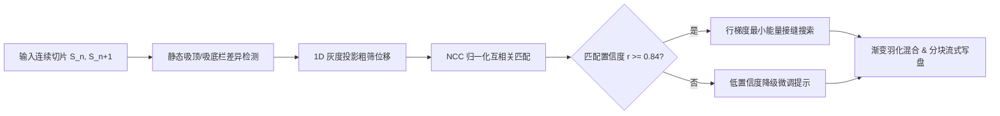

# 图像拼接算法与技术规范 (Stitching Engine Spec)

本文档详述 `ScrollSnap` 核心拼接引擎 `StitchEngine` 的数学模型、算法流水线与图像处理管线。

---

## 1. 拼接算法管线设计

连续屏幕截图拼接采用“**固定栏检测 + 粗筛位移估计 + 归一化互相关 (NCC) 精细对齐 + 最小能量接缝雕刻 (Seam Carving)**”的四级流水线：

---

## 2. 核心数学模型

### 2.1 静态吸顶导航栏与吸底固定栏检测 (Floating Bar Elimination)
移动端截图（微信聊天、Safari 网页、小红书）的核心痛点是每张图顶部均有相同的状态栏和联系人标题，底部有输入框或导航栏。若直接拼合会导致长图反复出现吸顶/吸底遮挡。

- **算法模型**：
  对比连续切片顶部 $H_{top} \in [0, 320]\text{px}$ 与底部 $H_{bottom} \in [0, 280]\text{px}$ 的垂直灰度差分：
  $$\Delta P_{top}(y) = |P_A(y) - P_B(y)|$$
  当连续 50 像素行内的 $\Delta P(y) \le 0.025$ 时，判定该区域为静态常驻浮动栏。
- **预设场景裁切策略**：
  - **聊天模式 (`chatRecord`)**：首图保留顶栏、裁去底栏；中间图同时裁去顶栏与底栏；尾图裁去顶栏、保留底栏。
  - **网页长文 (`webArticle`)**：中间图自动排除吸顶网址条与吸底工具栏。
  - **信息流 (`continuousFeed`)**：全图滚动，不裁剪边缘。

### 2.2 1D 垂直灰度投影 (Coarse Shift Estimation)
在有效可滚动视窗区域，对图片水平方向投影生成一维亮度积分序列：

$$P(y) = \frac{1}{W} \sum_{x=0}^{W-1} L(x, y)$$

其中 $L(x, y) = 0.299R + 0.587G + 0.114B$ 为 ITU-R BT.601 标称灰度值。通过对切片间滑动投影序列进行快速差分滑动窗口匹配，在 $O(H)$ 复杂度内将位移搜索范围压缩至 $\pm 40\text{ pt}$ 狭窄区间。

### 2.3 归一化互相关 (Normalized Cross-Correlation, NCC)
在初筛区间内，截取有效视窗顶端固定高度 $h_{tpl} = 120\text{ pt}$ 作为模板块 $T$。在搜索带 $S(y)$ 内滑动计算相关系数 $R(y)$：

$$R(y) = \frac{\sum_{i, j} \left( S(x_i, y + y_j) - \bar{S}_y \right) \left( T(x_i, y_j) - \bar{T} \right)}{\sqrt{\sum_{i, j} \left( S(x_i, y + y_j) - \bar{S}_y \right)^2 \sum_{i, j} \left( T(x_i, y_j) - \bar{T} \right)^2}}$$

- **判决门限**：
  - $R(y^*) \ge 0.84$：判定为高精度可靠重合点，记录垂直重叠偏移量 $\Delta y = y^*$。
  - $0.70 \le R(y^*) < 0.84$：触发多行边缘梯度校验；
  - $R(y^*) < 0.70$：标记为低置信度（纯色背景或高速跳帧），启用人工微调。

---

## 3. 最小能量接缝雕刻 (Optimal Seam Line Selection)

直接在固定像素偏移处截断往往会导致文字笔画被横向劈开，产生明显的接缝割裂感。引擎采用沿水平扫描线的横向能量积分求极小值点：

$$E(y) = \sum_{x=0}^{W-1} \left| \frac{\partial I}{\partial x}(x, y) \right| + \lambda \cdot \left| \frac{\partial I}{\partial y}(x, y) \right|$$

在对齐基准线 $\pm 24\text{ pt}$ 邻域内寻优：

$$y_{seam} = \arg\min_y E(y)$$

当扫描行位于文字行距空白处或气泡段落间隙时，$E(y)$ 呈现明显深槽谷值。在此行切开并在接缝处施加 4 像素范围的线性羽化（Alpha Feathering）：

$$\alpha(k) = \frac{k}{N}, \quad k \in [0, N-1]$$

确保接缝处过渡自然，无任何拼接痕迹。
